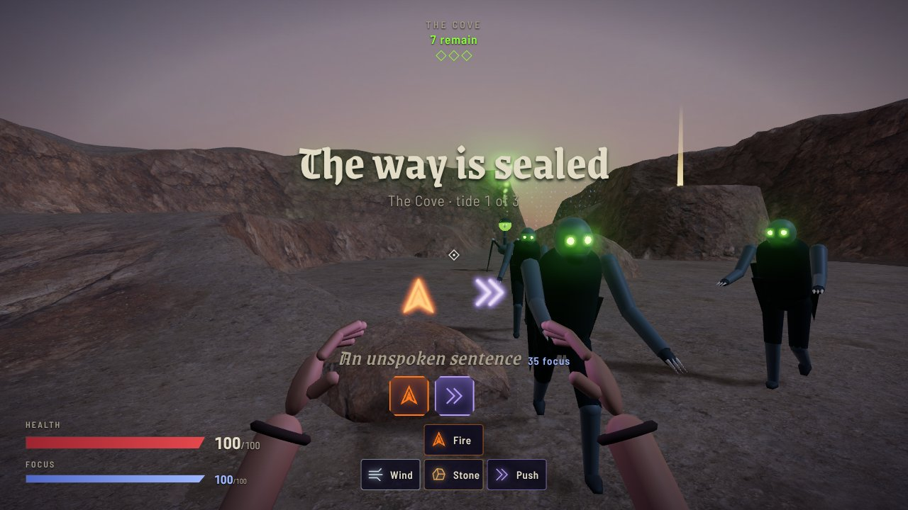
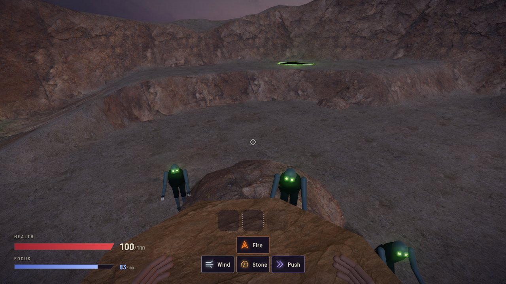

# Gloamtide

A first-person roguelike. You are a ship hand washed up on an island that is on no chart, beside a
dead mage and his journal. The journal teaches you words of magic. You speak them with the arrow
keys, combine them into sentences, and fight your way inland one night at a time. When you die the
tide carries you back to the shore, and the only thing you keep is what you know.



**Status:** first playable slice. The Wreck Shore is built: four sigils, fourteen sentences, two
creatures, one wave stand. The plan for the rest is in [docs/PLAN.md](docs/PLAN.md).

## Play

```
npm install
npm run dev
```

Open the address it prints. It needs a keyboard and a trackpad or mouse.

| Input | Action |
| --- | --- |
| W A S D | Move |
| Trackpad | Look and aim |
| Space | Jump |
| Left Shift | Dodge |
| Arrow keys | Speak a sigil. Two in a row make a sentence. |
| Click or Enter | Cast the sentence where you look |
| Backspace | Let the sentence go |
| E | Read a journal page |
| Tab | Your own journal: every sentence you have found |
| Esc | Pause |
| [ and ] | Look speed down and up |

The pause menu can teach you all four words at once, for testing, and can wipe what you know.

## What is in the slice

- **The Wreck Shore.** A beach, the two halves of the ship as ramps and decks, a ravine, and a cove
  with a low ledge and a high outcrop.
- **Four sigils:** Fire, Push, Stone, Wind. Each is taught by a journal page. In the full game they
  are spread across the first biomes; here they are all on the shore so the system can be tried.
- **Fourteen sentences**, from Firebolt to Gale. Seven are in the mage's journals; seven are yours
  to find. Stone Stone raises a pillar you can stand on. Wind Wind is an updraft.
- **Height matters.** The Drowned cannot climb. They walk the long way round to a ramp, leap onto
  low ledges, and wait under high ones. Anything thrown off a height takes fall damage, including you.
- **One stand:** three tides in the cove, sealed by wards until it is won.
- **Death and return.** You wake on the shore again knowing every word and sentence you had.



## Working on it

| Command | What it does |
| --- | --- |
| `npm run dev` | Run the game with live reload |
| `npm run build` | Type-check and build to `dist/` |
| `npm test` | Unit tests for the sentence grammar and the navigation grid |
| `npm run playtest` | Build, then play the loop headlessly and check ten rules of the game |
| `node tools/look.cjs shots` | Screenshot a set of situations from the built game |
| `npm run assets` | Re-download the scanned textures and sky from Poly Haven |

The headless tools need Playwright's Chromium (`npx playwright install chromium`).

| Folder | Contents |
| --- | --- |
| `src/magic` | Sigils, the sentence grammar (pure data), and what each spell does |
| `src/world` | Collision, navigation, and the Wreck Shore level |
| `src/enemies` | Creature behaviour |
| `src/player` | Movement, and the first-person hands |
| `src/game` | The loop, the stand, journals, saving |
| `src/art`, `src/fx`, `src/ui` | Materials, creature bodies, effects, HUD |
| `public/assets` | Scanned textures and sky (Poly Haven, CC0) |
| `art/` | Concept art and look-dev from the first, stylised direction |

Creature models are placeholders built in code. Sound is not in yet.
