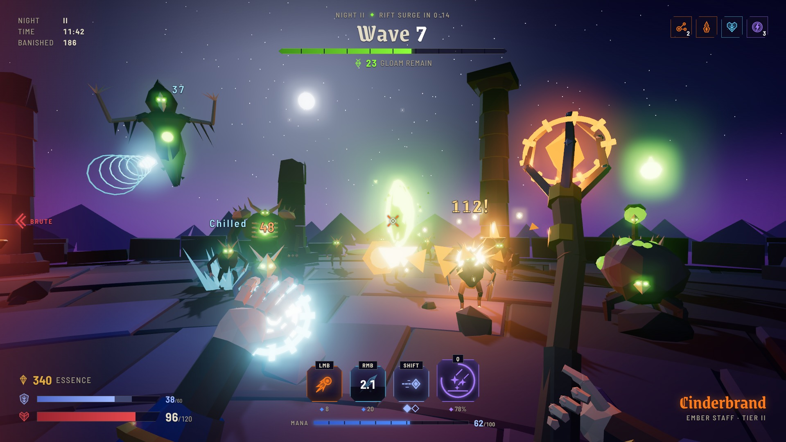
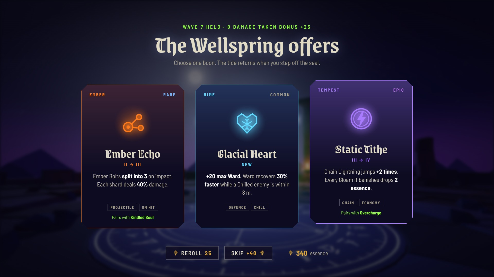
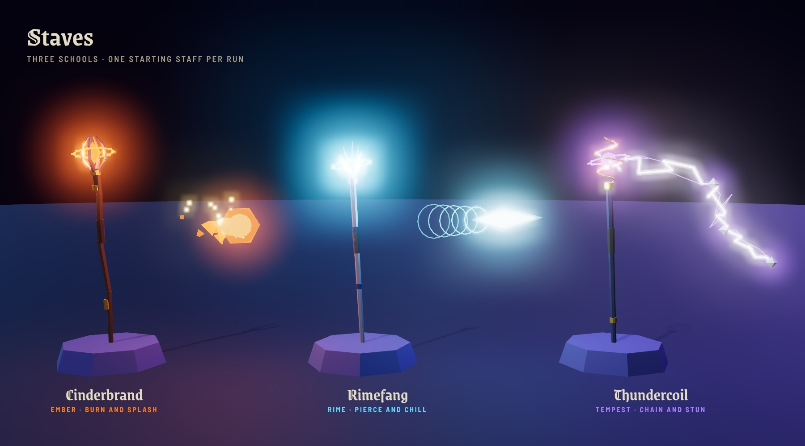
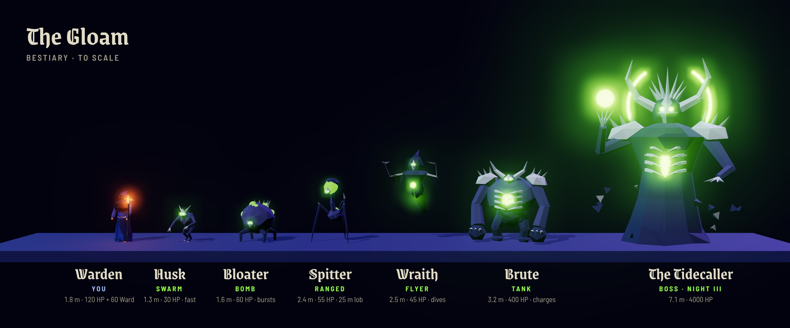
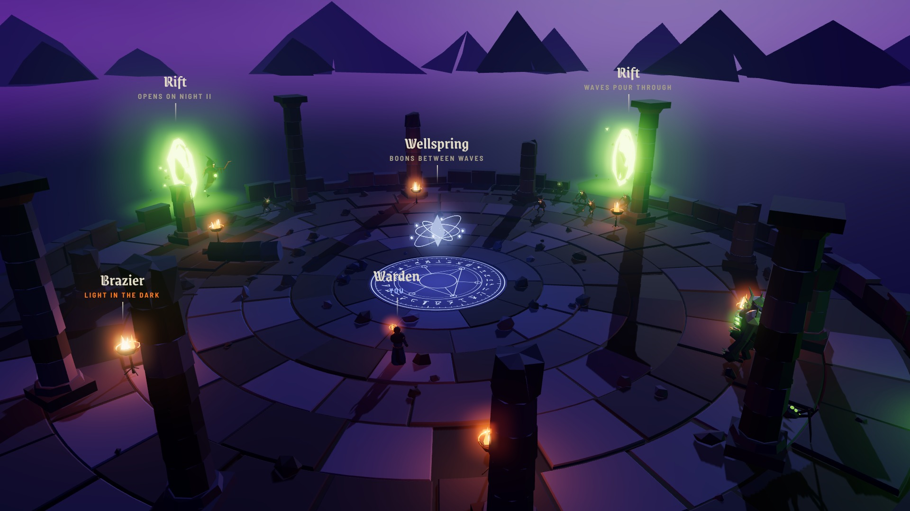
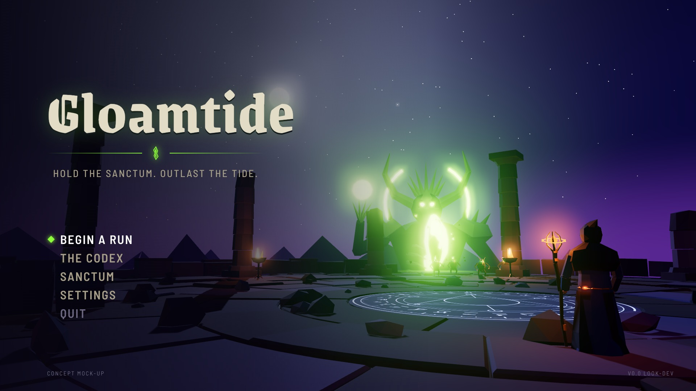

# Gloamtide: game plan

Status: **draft for review**. Nothing here is locked. The open questions at the bottom need answers
before we start building; everything else is a proposal you can push back on.



## The pitch

You are the **Warden**, the last mage of a ruined sanctum that floats above an abyss. Every night
the **Gloam** pour through rifts at the edge of the sanctum. You hold the ward seal at its centre with
a staff in one hand and a spell in the other.

It is a **first-person roguelike wave survival** game. A run is three Nights of five waves each,
about 25 minutes. Between waves the **Wellspring** offers you a choice of three boons, so every run
builds into a different mage. Die and the run is over, but some of what you earned carries into the next.

### Design pillars

1. **Spells feel physical.** Every cast has a wind-up, a projectile you can see, and an impact with
   weight. Mana replaces ammo, so the rhythm is cast, weave, recover, not reload.
2. **Builds come from boons.** Three schools of magic with combos between them. The fun is finding
   a combination that breaks the game a little.
3. **Readable chaos.** Forty enemies on screen must still be readable at a glance: every enemy has a
   unique silhouette, and the colour language is strict (green is always the Gloam; warm, cold and
   violet are always you).
4. **Short runs.** 20 to 25 minutes, so one more run is always tempting.

## Core loop

```
 ┌──────────── Run (≈25 min) ─────────────────────────────────────────────┐
 │                                                                       │
 │  Night I: waves 1–5    Night II: waves 6–10    Night III: waves 11–15 │
 │  1 rift open           3 rifts open            3 rifts + elites       │
 │  wave 5: Brute elite   wave 10: twin Brutes    wave 15: the Tidecaller│
 │                                                                       │
 │   wave (60–120 s)  →  Wellspring (untimed)  →  next wave …            │
 │   fight, gather        pick 1 of 3 boons,                             │
 │   essence              heal / reroll with essence                     │
 └───────────────────────────────────────────────────────────────────────┘
          win → endless mode + higher Tide level     lose → Starlight (meta currency)
```

- **In a wave:** kill everything the director sends. Enemies drop **essence**, which is pulled to you
  when you get close.
- **Between waves:** step onto the ward seal. The Wellspring offers three boons; pick one. Spend
  essence to reroll, to heal, or skip the pick for extra essence. Step off the seal to start the next wave.
- **After each Night's last wave:** choose a **relic** (a bigger, run-defining effect) and a new rift opens.
- **Run end:** beating the Tidecaller unlocks endless mode and the next **Tide level** (stacking
  difficulty modifiers, like Ascension or Heat). Dying converts leftover essence into **Starlight**.
- **Between runs (the Sanctum):** spend Starlight on new staves, new spells, new boons added to the
  pool, and small permanent stat upgrades. Unlocks should widen choice more than raw power.



## The Warden (player kit)

| Input | Action | Notes |
| --- | --- | --- |
| WASD, Space | Move, jump | Fast arena movement, about 7 m/s with full air control. No sprint. |
| Mouse | Look and aim | |
| LMB | Staff primary | Cheap, spammable, defined by the staff you chose. |
| RMB | Secondary spell | Costly, on a cooldown. Picked at run start, swappable through boons. |
| Shift | **Blink** | Short teleport, about 6 m. Two charges, 4 s recharge each. Your main defensive tool. |
| Q | Ultimate | Charged by dealing damage. Starfall to start; others unlock. |

**Vitals:** Health 120 (does not regenerate during a wave; heal at the Wellspring). Ward 60 (a shield
that regenerates after 3 s without taking damage). Mana 100, regenerating about 18 per second.

### Staves (choose one at the start of a run)



| Staff | School | Primary | Status effect | Feel |
| --- | --- | --- | --- | --- |
| **Cinderbrand** | Ember | Ember Bolt: fast projectile with a 2 m splash, about 3 casts/s | **Burn**: damage over time, stacks | Crowd control through area damage |
| **Rimefang** | Rime | Frost Lance: near-instant piercing lance, about 1.5 casts/s, high damage | **Chill**: 40% slow; 5 stacks **Freeze** for 2 s | Precision, picks off priority targets |
| **Thundercoil** | Tempest | Chain Lightning: hold to channel a short-range arc that jumps to 3 targets | **Shock**: builds up, then stuns for 1 s and makes the target take more damage | Sustained, close and mid range |

### Combos between schools

Mixing schools is where builds get interesting, so cross-school combos are a first-class system:

- **Shatter** (Rime + any hit on a Frozen enemy): double damage, and the enemy bursts into ice shards.
- **Steam** (Ember + Rime): Burn and Chill cancel into a cloud that blinds enemies inside it.
- **Overload** (Tempest + Ember): a Shocked enemy that is Burning explodes.

## The Gloam (enemies)



| Enemy | Role | HP | Behaviour | How you beat it |
| --- | --- | --- | --- | --- |
| **Husk** | Swarm | 30 | Fast (about 6.5 m/s) melee, comes in packs of 6–12 | Splash damage, chains |
| **Spitter** | Artillery | 55 | Keeps 15–25 m away, lobs slow arcing bolts that leave a damaging puddle | Blink in close, or a Frost Lance from range |
| **Bloater** | Walking bomb | 60 | Slow; explodes on death for 30 damage in 4 m, **hurting other Gloam too** | Pop it inside a pack, far from you |
| **Wraith** | Flyer | 45 | Hovers 3–6 m up, flashes green, then dives | Track it; Chain Lightning ignores your aim |
| **Brute** | Tank | 400 | Slow, then a telegraphed charge with knockback. Glowing chest takes double damage | Blink sideways, punish the chest |
| **The Tidecaller** | Boss | 4000 | Three phases: summons from its chest rift; ring slams you jump over; finally tears a rift open at the centre and dims the Wellspring | Learn the pattern |

Later waves add **elite modifiers** to regular Gloam: Warded (shielded), Hasted, Splitting (Husks
burst into smaller Husks), Volatile (explode on death).

## Waves and the director

- Each wave gets a **threat budget** that grows with the wave number. The director spends it on
  groups (a pack of Husks, a Spitter pair, a Brute) and spawns them from the open rifts, so pressure
  comes from more than one side as the Nights go on.
- A cap of about 40 live enemies keeps both performance and readability in check. When the cap is hit,
  spawns queue at the rift and the rift visibly swells.
- A wave ends when its budget is spent and everything is dead. A short breather and an audio sting
  mark the end before the Wellspring wakes.

## Boons, relics and essence

- About 40 boons at launch across the three schools plus neutral ones. Rarities: Common, Rare, Epic,
  Legendary. Picking a boon you already have levels it up (II, III, IV).
- Boons are tagged (Projectile, Chain, Chill, Economy, Defence…) so the draft can lean toward your
  build without forcing it.
- Essence prices: reroll 25 (+10 per reroll in the same draft), heal 30 HP for 40, skip a pick for +40.

A first set to prototype with:

| Boon | School | Effect |
| --- | --- | --- |
| Ember Echo | Ember | Ember Bolts split into 3 on impact, each shard deals 40% |
| Kindled Soul | Ember | Each kill while Burning enemies are nearby grants +5% fire damage for 6 s, stacking |
| Cinder Trail | Ember | Blink leaves a line of fire |
| Glacial Heart | Rime | +20 max Ward; Ward recovers 30% faster near a Chilled enemy |
| Brittle Bones | Rime | Shatter deals +50% and spreads Chill |
| Rime Shell | Rime | When Ward breaks, Freeze everything within 5 m (20 s cooldown) |
| Static Tithe | Tempest | Chain Lightning jumps +2 times; kills by lightning drop 2 essence |
| Overcharge | Tempest | Casting at full mana deals +40% damage |
| Storm Step | Tempest | Blink leaves a lightning burst at both ends |
| Wardweaver | Neutral | +1 Blink charge |
| Starseeker | Neutral | Ultimate charges 30% faster |
| Essence Tithe | Neutral | Essence pickup radius doubled; +10% essence |

## The arena: the Sanctum



A circular ruin about 48 m across, floating above the abyss. It is one arena on purpose: depth comes
from enemies and builds, not from map variety.

- **Ward seal and Wellspring** at the centre: safe ground between waves, the place you choose boons.
- **Twelve pillars** in a ring, some broken. Cover from Spitters, and obstacles for chasers.
- **Four rift gates** in the outer wall, each flanked by a pair of pillars. Night I opens the north
  rift; Night II adds east and west; Night III can open the fourth.
- **Braziers** light the outer ring and give the space warm pools to read the floor by.
- Falling off the edge is possible (Blink carelessly near a gap), and costs 25% of max health
  before you are pulled back by the ward.

A second arena (a different biome with its own hazards) is a post-launch idea, not in scope.

## Art direction

All of the concept art in `art/concept/` is rendered from real three.js scenes in `art/lookdev/`.
It is not paintover, so it shows what the engine will actually draw.

- **Style:** low-poly, flat-shaded facets, no textures. Characters are built from a small kit of
  primitives so new enemies stay consistent and cheap.
- **Palette** (`art/lookdev/src/palette.js` is the source of truth):
  - Night: deep indigo sky, violet horizon, a cold moon.
  - Stone: desaturated indigo greys.
  - The Gloam: dusk-purple hide, pale bone masks, **toxic green** light. Green belongs only to the
    enemy and its attacks.
  - Player magic: Ember orange, Rime cyan, Tempest violet. Ward and UI accents are periwinkle.
  - Health red and essence gold only appear in the HUD.
- **Silhouette first:** every enemy must be identifiable as a black shape. Every Gloam wears the same
  diamond bone mask with two green eyes, which makes them read as one faction.
- **Light:** moonlight key with soft shadows, warm braziers, coloured point lights from rifts and
  spells, and bloom on anything emissive.
- **Type:** Grenze Gotisch for display (wave numbers, names, title), Barlow Semi Condensed for UI text
  and numbers.
- **HUD:** vitals bottom-left, spell bar and mana bottom-centre, staff bottom-right, wave and tide
  meter top-centre, boons top-right. Damage numbers in the colour of the school that dealt them.



## Technology

**Recommendation: TypeScript + three.js + Vite, running in the browser.**

- The models, palette and lighting in the look-dev kit are already three.js code, so they carry
  straight into the game instead of being remade.
- It runs anywhere with a link (and can ship on itch.io or be wrapped for Steam later with Electron
  or Tauri).
- Iteration is fast: save, reload, play. Builds and tests can run headlessly, which suits building
  it together in sessions like this one.

The alternative is **Godot 4**: better for a commercial PC or console release, with built-in physics,
navigation, an editor, and native performance. The art would not be wasted, since the three.js kit
can export glTF models with `GLTFExporter`. This is the first open question below.

### Architecture (web version)

- **Game loop:** fixed 60 Hz simulation, rendering interpolated at display rate.
- **Entities:** a light component setup (transform, health, status effects, AI brain, collider)
  with systems for input, movement, casting, projectiles, AI, director, damage and status, effects, and UI.
- **Collision:** the arena is a circle with round pillars, so player and enemy collision against the
  world is capsule against cylinders, written by hand. No physics engine needed at first.
- **AI:** steering behaviours (seek, separate, avoid pillars, keep distance for ranged, 3D steering for
  flyers). No navmesh needed in an open round arena.
- **Rendering:** instanced meshes for swarm enemies, merged static arena geometry, pooled projectiles
  and effects, and one bloom pass.
- **UI:** HTML and CSS over the canvas, as in the mock-ups.
- **Data:** boons, enemies and waves defined in data tables so balancing does not need code changes.
- **Saves:** meta progression in local storage.
- **Target:** 60 fps at 1080p on integrated graphics with 40 enemies on screen.

## Milestones

| Milestone | Scope | Done when |
| --- | --- | --- |
| **M0: Plan** (this) | Plan, concept art, look-dev kit | You have given feedback and we have answered the open questions |
| **M1: Greybox** | Project setup, first-person controller (move, look, jump, Blink), arena collision, Ember Bolt, Husks that chase, health and death, a basic HUD | Shooting Husks already feels good |
| **M2: Core loop** | Wave director, Spitter and Bloater, Wellspring boon draft with about 9 boons, essence, run end and restart | A full 5-wave Night is playable start to finish |
| **M3: Content** | All three staves, status effects and combos, Wraith and Brute, all three Nights, about 25 boons, relics, ultimate | A full 15-wave run with real build variety |
| **M4: Boss and polish** | The Tidecaller fight, audio, effects polish, title screen, settings, Sanctum meta progression | Feels like a game, not a prototype |
| **M5: Balance and release** | Playtests, tuning, performance pass, release build | Shareable build on itch.io |

## Open questions for you

1. **Engine:** web (three.js, recommended) or Godot? Something else?
2. **Run length:** three Nights of five waves (about 25 minutes), or endless from the start?
3. **Staves:** one staff per run chosen at the start (proposed), or find and swap staves during a run?
4. **Art style:** keep the low-poly, faceted night look, or go another way (pixel-retro, painterly,
   more realistic)?
5. **Name:** keep *Gloamtide* as the working title?
6. **Players:** single-player only, or co-op later? Co-op changes the architecture early, so it is
   better to decide now.
7. **Controls:** mouse and keyboard only, or gamepad as well?

## Art index

| File | What it shows |
| --- | --- |
| `art/concept/keyart.jpg` | First-person mid-wave with the full HUD |
| `art/concept/draft.jpg` | Boon draft at the Wellspring |
| `art/concept/title.jpg` | Title screen |
| `art/concept/arena.jpg` | The Sanctum, annotated |
| `art/concept/lineup.jpg` | All enemies and the Warden, to scale |
| `art/concept/staves.jpg` | The three starting staves and their spells |
| `art/concept/{husk,spitter,bloater,wraith,brute,tidecaller}.jpg` | Single-enemy turnarounds |
| `art/ui/icons/*.svg` | Spell, vitals and boon icons |
